# WSARTEX en català

Pedaç de traducció **parcial i ampliada** de la interfície web de [WSARTEX](https://github.com/willsurpass/WSARTEX), una plataforma de proves de seguretat amb agents d'intel·ligència artificial.

La localització modifica **71 fitxers** i inclou, entre altres apartats, el menú, l'inici de sessió, la vista general, Converses, Tasques, Troballes, Actius, Sincronització, Notificacions i pantalles de Sistema. També inclou etiquetes de gràfics i formats catalans de data i hora.

La traducció es distribueix com a **pedaç independent**: no inclou una còpia completa del projecte original. Cal obtenir el codi font de WSARTEX per separat.

## Compatibilitat i abast

- **Revisió del codi font de referència:** `c26bca6304ce5d26b7eb2cddfabe57721400824b`.
- **Data de la localització:** 20 de novembre de 2026.
- **Estat:** traducció parcial; algunes cadenes de text encara poden aparèixer en altres llengües.

Els textos modificats s'han pogut extreure mantenint l'estructura del codi. Queden fora d'aquest pedaç les traduccions que requereixen lògica nova, les dades procedents del servidor, les descripcions desades i les dades de demostració.

El pedaç utilitza un *diff* amb línies modificades i sense línies de context. Encara que no distribueix el repositori complet, el diff pot incloure fragments de codi original corresponents a les línies modificades.

## Aplicació i reversió

1. Obté una còpia neta del [repositori WSARTEX](https://github.com/willsurpass/WSARTEX) en la revisió indicada.
2. Des de l'arrel de la còpia, comprova que el pedaç s'hi pot aplicar:

   ```sh
   git apply --unidiff-zero --index --check /ruta/al/wsartex-catala.patch
   ```

3. Aplica'l:

   ```sh
   git apply --unidiff-zero --index /ruta/al/wsartex-catala.patch
   ```

4. Compila i inicia WSARTEX seguint la [documentació del projecte original](https://github.com/willsurpass/WSARTEX/blob/main/README.en.md).

Per revertir els canvis:

```sh
git apply --unidiff-zero --index --reverse /ruta/al/wsartex-catala.patch
```

> **Atenció:** el pedaç és específic d'una revisió. Comprova'n sempre l'aplicació i els resultats abans de compilar o executar el programa. Una instal·lació que només contingui un executable o fitxers web compilats necessita el codi font compatible.

## Captures de pantalla

Captures de la interfície executada amb la localització aplicada. Algunes dades de configuració s'han ocultat expressament.

| | |
| --- | --- |
| 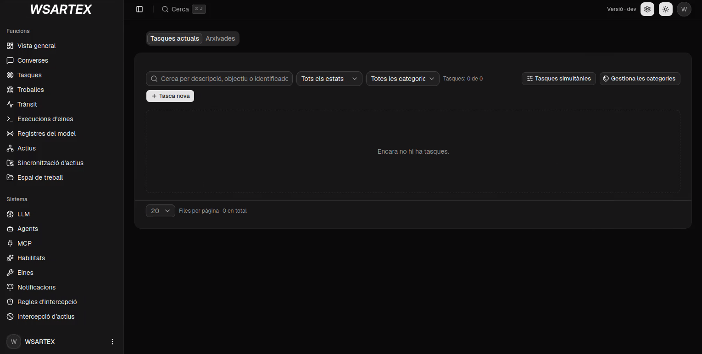 | 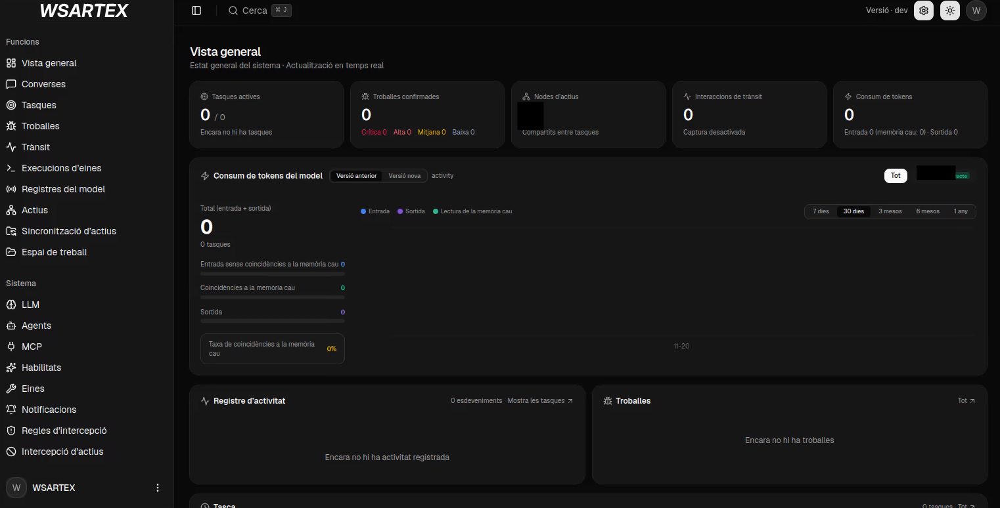 |
| 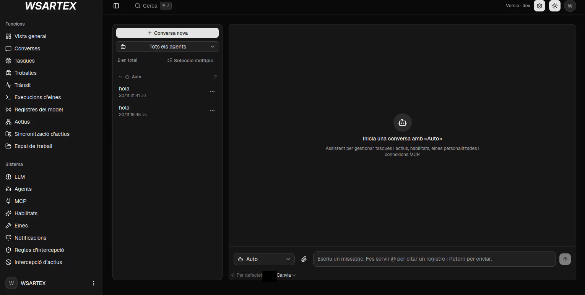 | 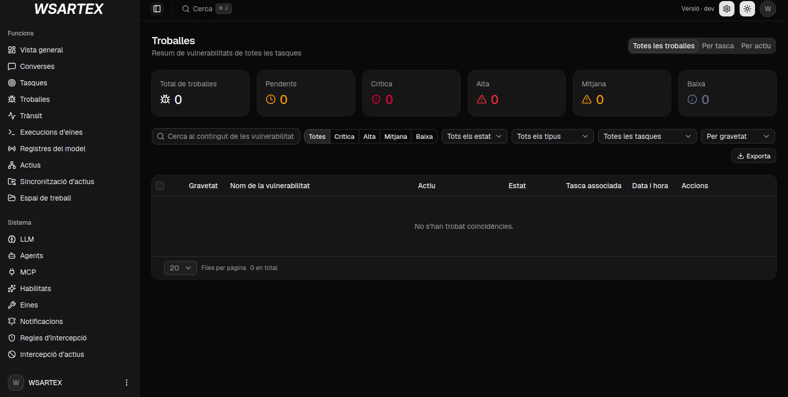 |
| 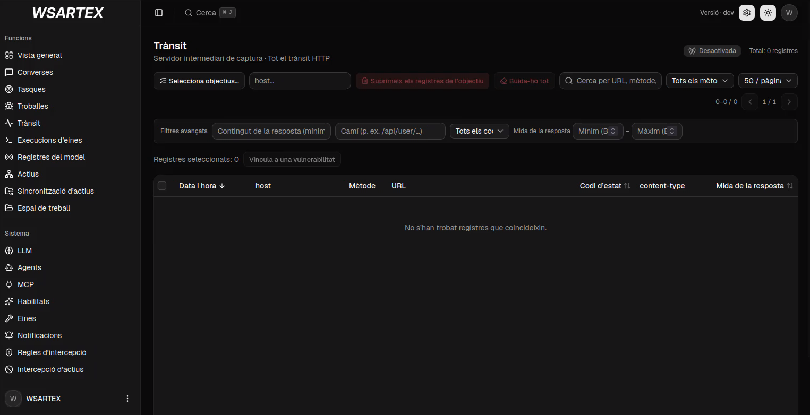 | 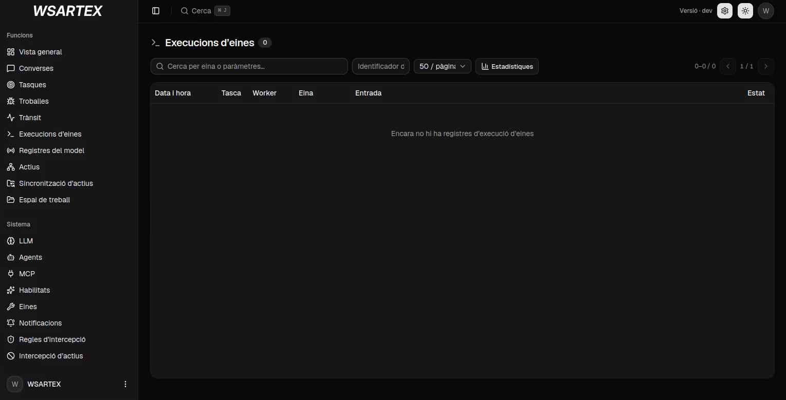 |
| 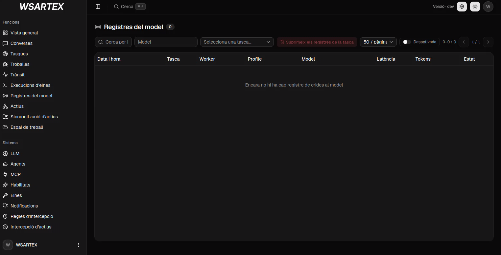 | 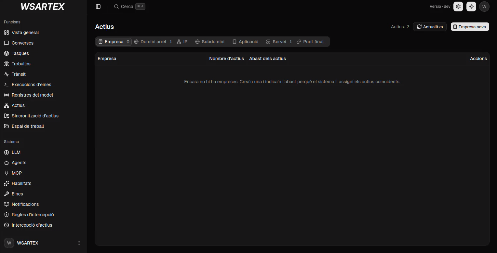 |
| 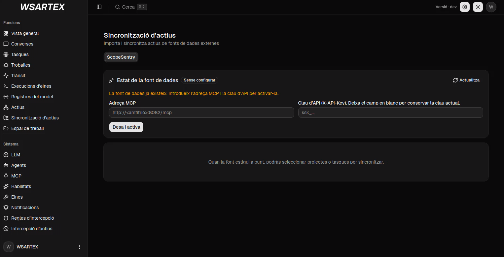 | 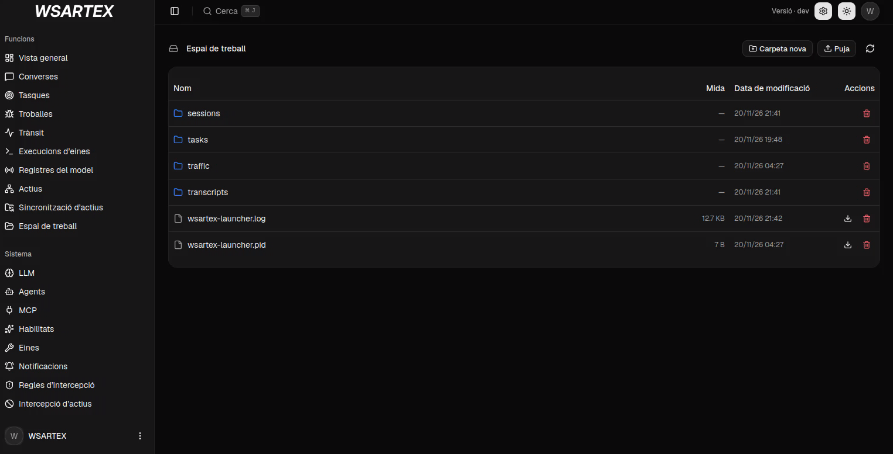 |
| 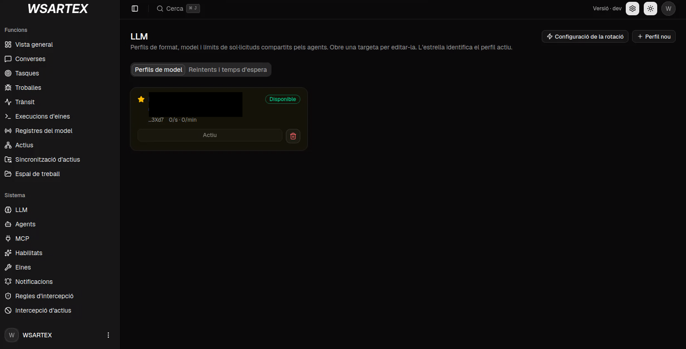 | 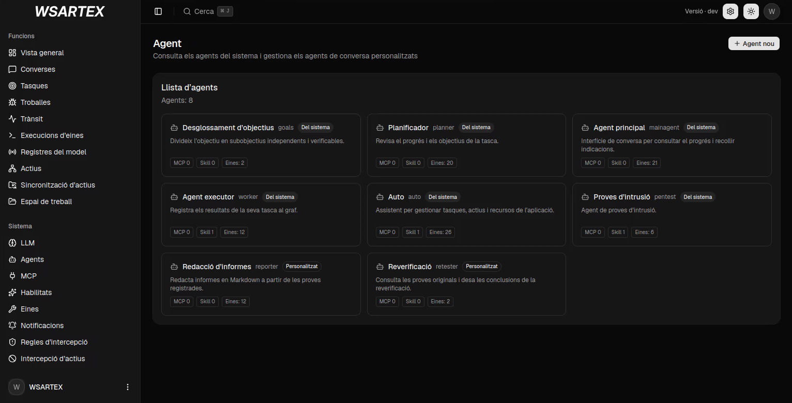 |
| 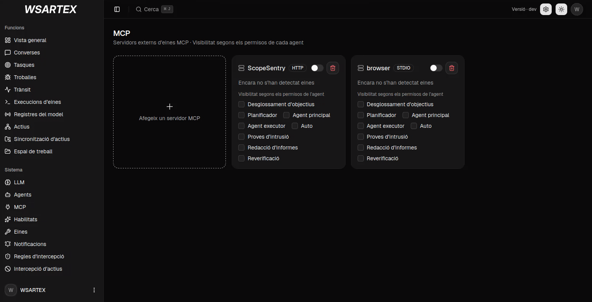 | 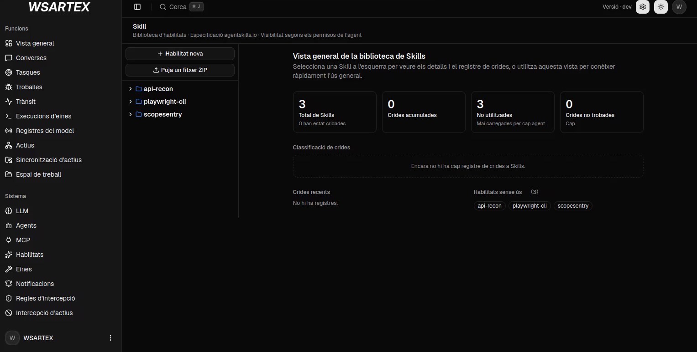 |
| 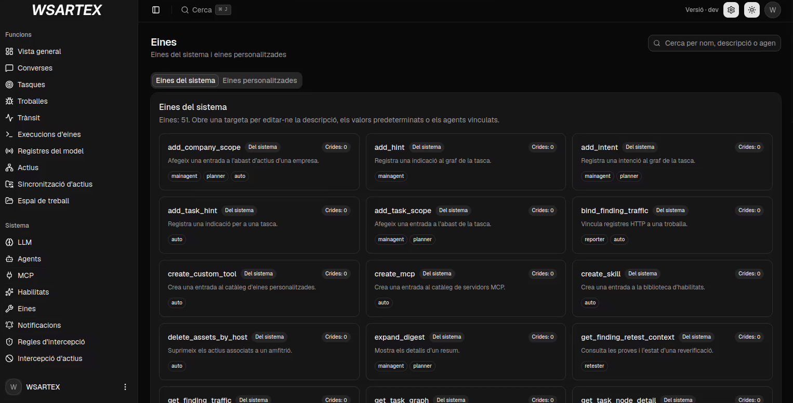 | 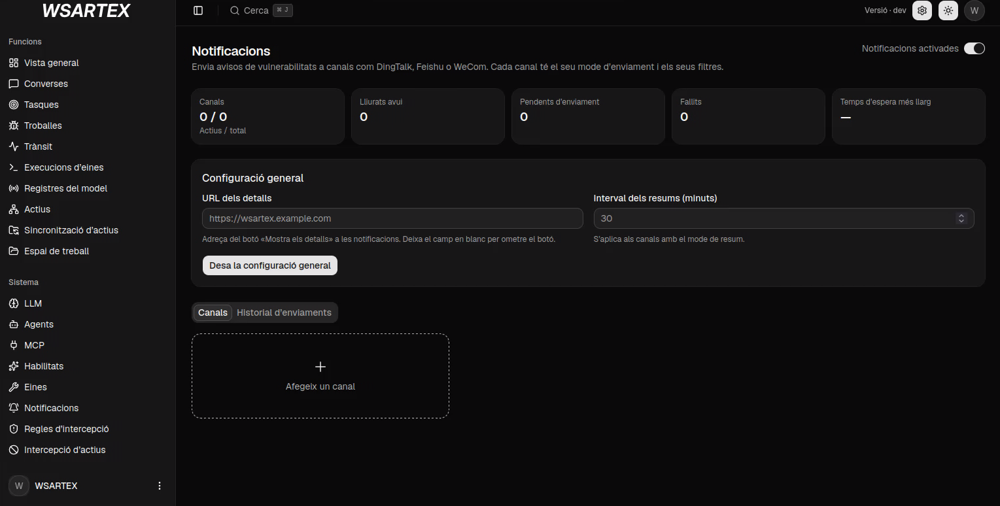 |
| 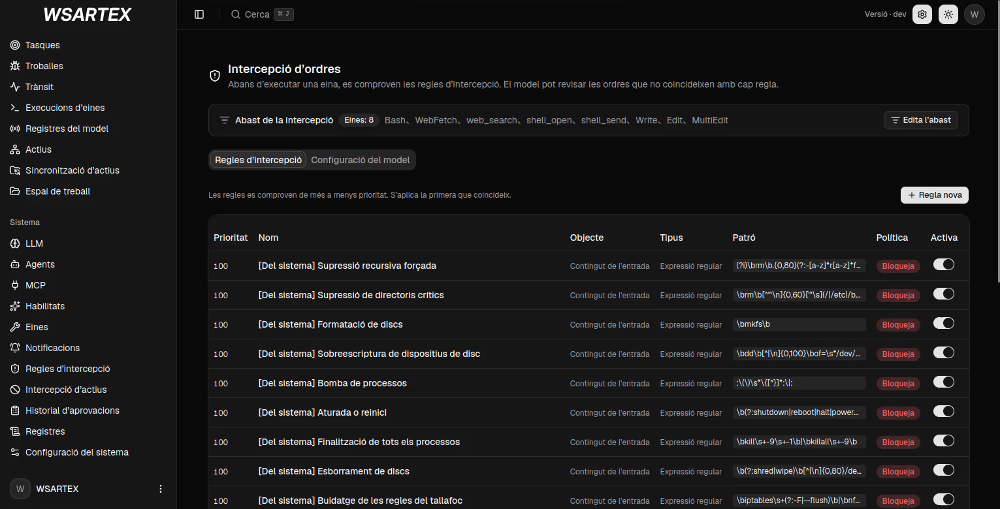 | 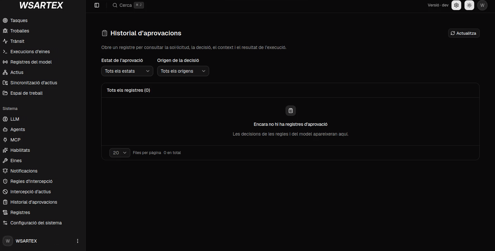 |
| 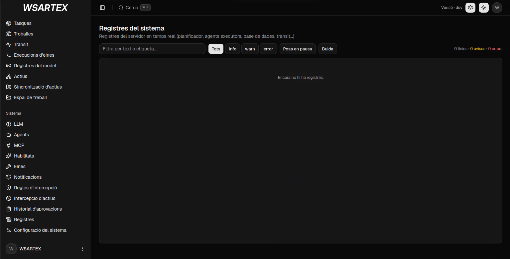 | 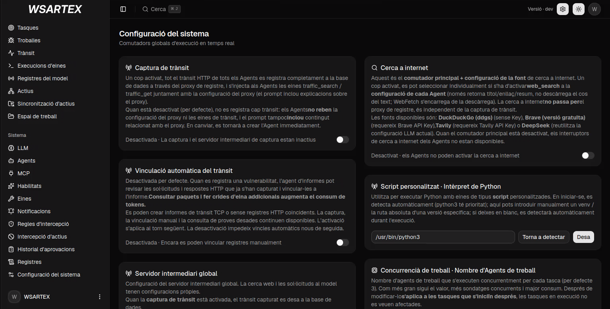 |

## Autoria, projecte original i llicència

La localització catalana és una modificació de WSARTEX. El codi i els recursos originals corresponen als seus respectius autors i col·laboradors. Consulta el [repositori original](https://github.com/willsurpass/WSARTEX) i els avisos de tercers del projecte.

El pedaç es distribueix sota la llicència **AGPL-3.0-or-later**; consulta [LICENSE](LICENSE). Cal conservar els avisos i respectar les obligacions de la llicència aplicables a qualsevol distribució o desplegament.

WSARTEX és una eina de ciberseguretat amb capacitat d'executar accions sobre sistemes. Utilitza-la només en entorns propis o amb autorització expressa.
